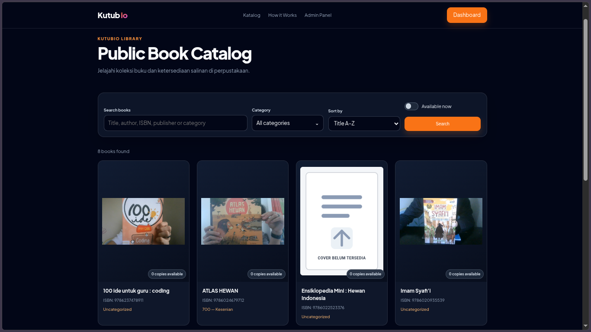
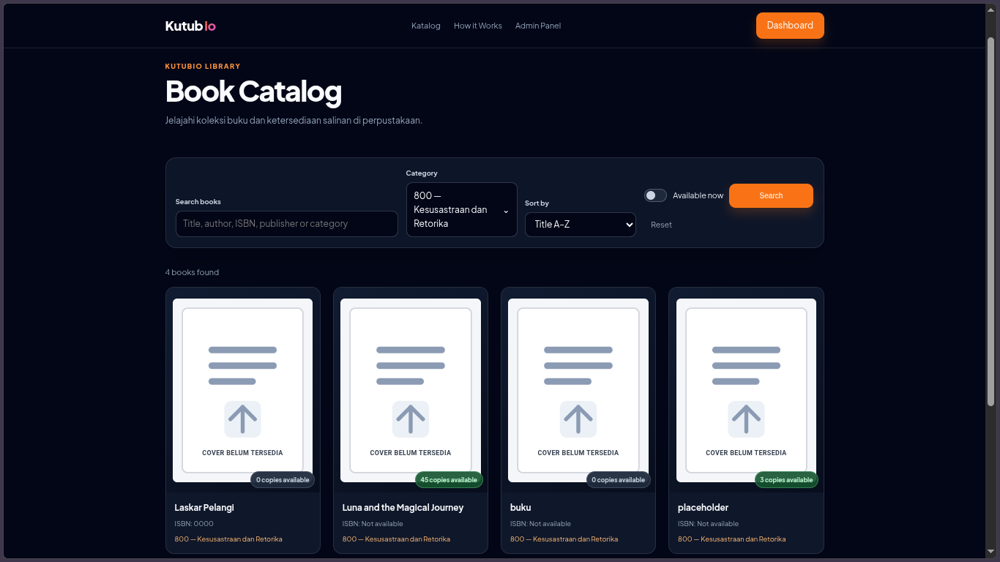
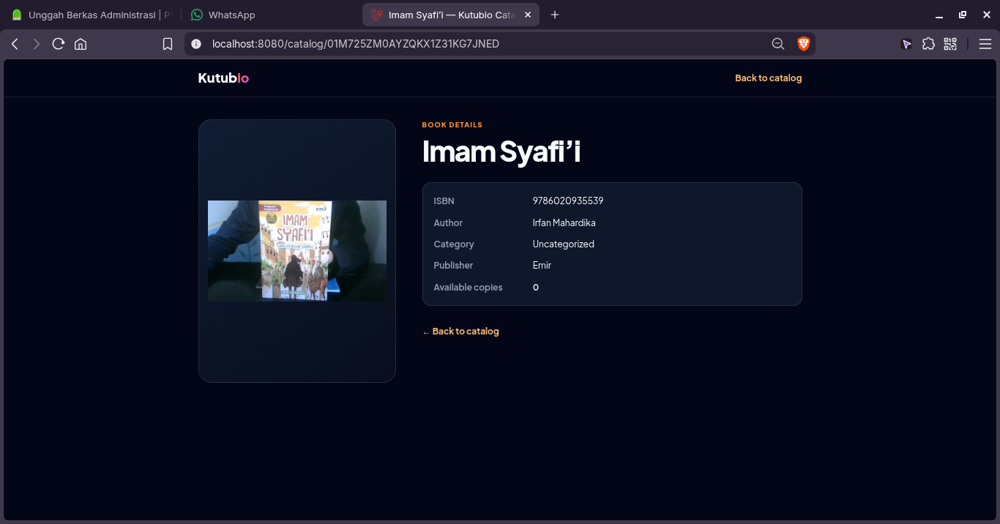
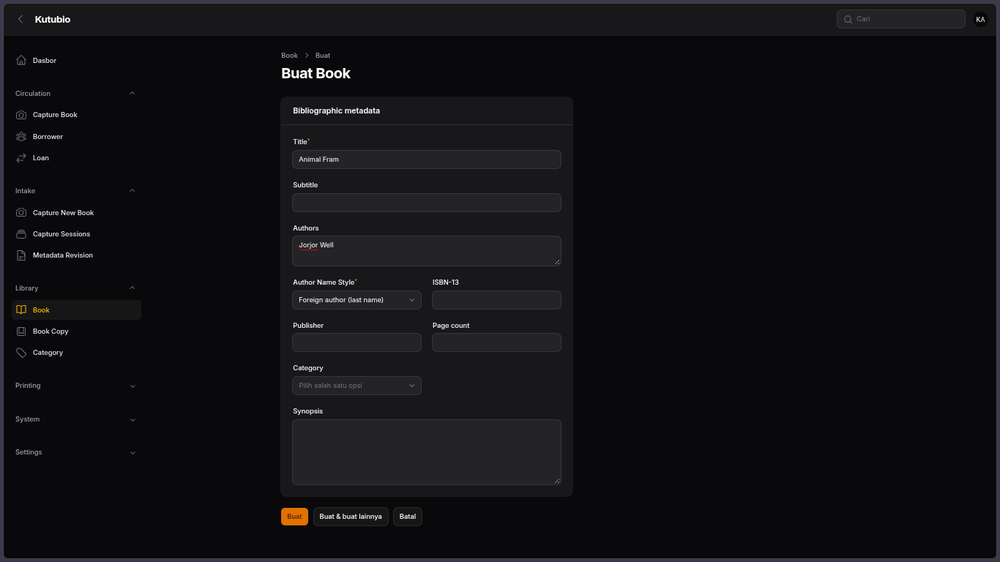
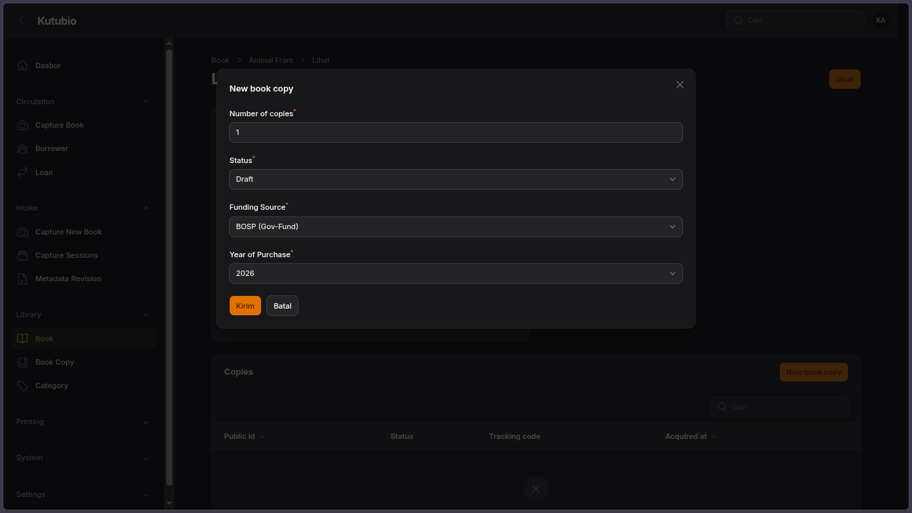
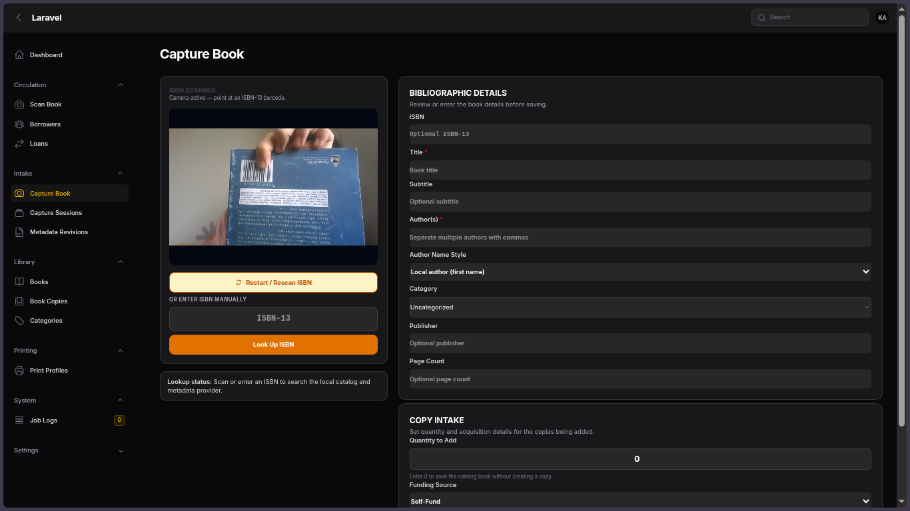
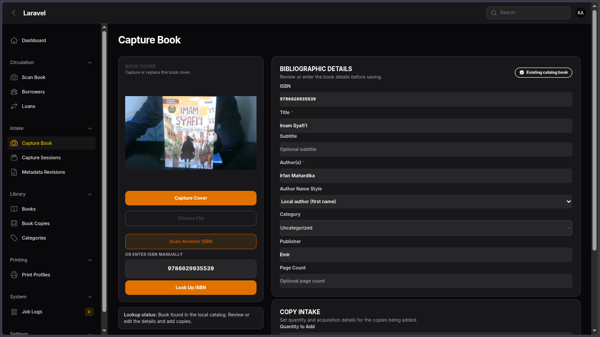
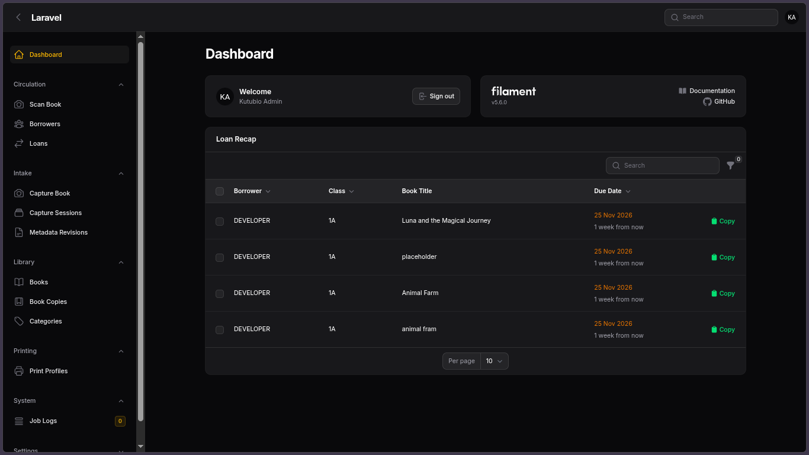
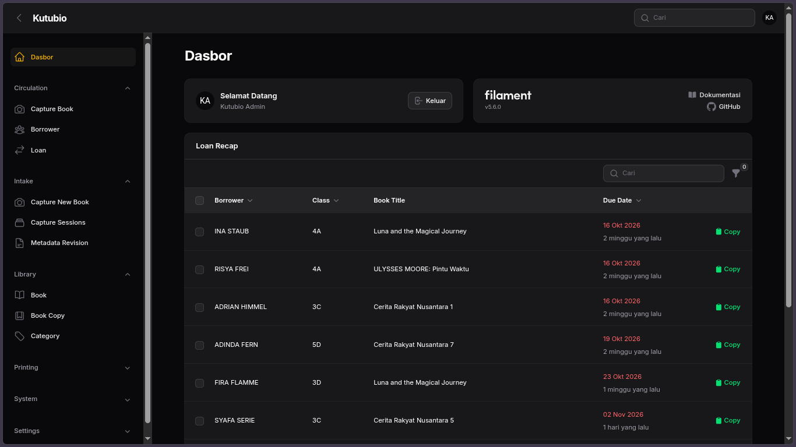

# Kutubio

[Read the English documentation](README.md)

Dokumentasi bahasa Indonesia utama Kutubio. Staf mengelola data bibliografi, eksemplar fisik, peminjam, peminjaman, intake buku, proses QR/barcode, dan bahan cetak. Pengunjung dapat menjelajahi katalog buku publik tanpa login.

## Daftar isi

- [Fitur](#fitur)
- [Teknologi](#teknologi)
- [Persyaratan](#persyaratan)
- [Pengembangan lokal](#pengembangan-lokal)
- [Katalog publik](#katalog-publik)
- [Alur admin](#alur-admin)
- [Layanan opsional](#layanan-opsional)
- [Konfigurasi](#konfigurasi)
- [Tes dan gaya kode](#tes-dan-gaya-kode)
- [Catatan produksi](#catatan-produksi)
- [Screenshot](#screenshot)

## Fitur

### Katalog publik

- Katalog read-only untuk guest tersedia di `/` dengan pagination.
- Kartu menampilkan cover atau placeholder, judul, ISBN, kategori, dan jumlah eksemplar berstatus tersedia.
- Rekomendasi pencarian dan grid hasil berubah bersama setelah jeda singkat saat mengetik. Pencarian hanya mencakup metadata buku; data peminjam dan peminjaman tidak dicari.
- Filter kategori dan ketersediaan serta pengurutan tersedia.
- Kartu membuka halaman detail buku publik read-only. Halaman detail menampilkan metadata bibliografi yang disetujui, tanpa aksi admin, data peminjam/peminjaman, atau detail eksemplar.
- Pengiriman cover publik dibatasi ke path `book-covers/`.

### Buku dan eksemplar fisik

- Kelola bibliografi: judul, subtitle, penulis, ISBN, penerbit, jumlah halaman, kategori, dan sinopsis.
- Satu Book dapat memiliki beberapa eksemplar fisik. Setiap eksemplar memiliki public ID, payload QR, status sirkulasi, sumber dana, tahun pengadaan, tracking code, tanggal pengadaan, dan catatan lokasi.
- Tambahkan eksemplar melalui tabel Copies pada halaman Book. Eksemplar terpilih dapat dicetak, diedit secara massal pada field yang didukung, atau dihapus.
- Bulk edit mempertahankan field yang tidak diubah. Eksemplar Borrowed dikecualikan dari perubahan availability; bulk edit tidak dapat menetapkan status Borrowed. Public ID dan payload QR tidak dapat diubah.
- Soft delete Book juga melakukan soft delete pada copies-nya; foreign key database melakukan cascade pada hard delete.

### Intake Capture Book

- Scan barcode ISBN atau masukkan ISBN secara manual, lalu cari metadata lokal dan eksternal.
- Provider metadata mencakup Perpusnas, dataset katalog Indonesia, Google Books, dan Open Library.
- Cover dapat diambil melalui kamera browser atau dipilih sebagai file. Cover baru menjadi draft hingga Save Book; saat disimpan, cover aktif diganti.
- ISBN yang cocok dengan Book lokal memperbarui Book tersebut. Book baru dapat disimpan dengan quantity nol.
- Author wajib diisi. Author Name Style default Local; kategori opsional dan dapat dicari dengan nama atau kode DDC.

### Peminjam dan sirkulasi

- Kelola peminjam siswa, guru, staf, dan tamu.
- Impor roster dari Google Sheets melalui pengambilan CSV, preview, review, dan persetujuan eksplisit.
- Format ID impor `student-YYZZAABB`. Contoh: tahun ajaran `26/27`, kelas `1A`, nomor absen `01` menghasilkan `student-26271101`.
- Buat peminjaman untuk peminjam aktif dan eksemplar tersedia. Pengembalian memperbarui status loan dan copy.
- Filter pinjaman, pantau sirkulasi aktif, dan cetak laporan terpilih.

### Cetak dan AI opsional

- Atur print profile dan buat lembar stiker QR/barcode, kartu buku, serta laporan peminjaman.
- Ollama dapat menyediakan OCR dan kategorisasi berbantuan AI.
- Pembuatan PDF membutuhkan layanan Gotenberg yang dapat dijangkau.

## Teknologi

- PHP 8.5 (batas Composer `^8.4`)
- Laravel 13
- Filament 5
- Livewire 4
- PostgreSQL (produksi; `.env.example` default ke SQLite)
- Redis dan queue/cache database sesuai konfigurasi
- Docker Compose / Laravel Sail untuk pengembangan lokal
- Vite dan Tailwind CSS 4
- Ollama dan Gotenberg bersifat opsional

## Persyaratan

- Docker Engine dengan plugin Docker Compose
- Git
- Checkout repository ini

Ollama, Gotenberg, dan provider metadata hanya dibutuhkan oleh fitur terkait. Akses kamera browser mensyaratkan HTTPS atau localhost dan izin pengguna.

## Pengembangan lokal

1. Buat konfigurasi environment lokal:

   ```bash
   cp .env.example .env
   ```

2. Atur `APP_URL`, database, dan `APP_PORT` bila diperlukan. Dalam Sail, gunakan hostname database dari Docker Compose; `localhost` di container bukan host komputer.
3. Jalankan layanan:

   ```bash
   vendor/bin/sail up -d
   ```

4. Pasang dependency dan siapkan aplikasi:

   ```bash
   vendor/bin/sail composer install
   vendor/bin/sail artisan key:generate
   vendor/bin/sail artisan migrate --seed
   vendor/bin/sail npm install
   vendor/bin/sail npm run build
   ```

5. Buka URL lokal sesuai konfigurasi, umumnya `http://localhost:8080`.

Jangan jalankan `migrate:fresh` pada database berisi data. Jangan pernah menjalankannya di produksi.

## Katalog publik

- Buka `/` tanpa login.
- Cari judul, penulis, ISBN, penerbit, nama kategori, atau kode DDC. Setelah jeda singkat saat mengetik, rekomendasi dan kartu hasil katalog diperbarui bersamaan.
- Filter kategori dan ketersediaan serta pilih pengurutan. Nilai filter dan halaman tercermin pada URL.
- Pilih kartu untuk membuka detail Book publik read-only.
- Hitungan ketersediaan hanya mencakup copy berstatus Available. Borrowed, Draft, Lost, dan status lainnya tidak dihitung.
- Semua Book yang tidak soft-deleted saat ini ditampilkan. Field publik mencakup judul, ISBN, kategori, cover, dan bibliografi yang disetujui.
- Cover memang dapat diakses guest. Jangan menyimpan file rahasia di path penyimpanan cover publik.








## Alur admin

### Tambahkan Book dan copies secara manual

1. Login, lalu buka **Library → Books**.
2. Buat bibliografi buku.
3. Buka halaman Edit Book dan tambahkan eksemplar melalui tabel Copies.
4. Atur quantity dan detail pengadaan.

   
   


### Intake buku berdasarkan ISBN

1. Buka **Capture Book** di menu admin.
2. Izinkan akses kamera untuk scan ISBN atau masukkan ISBN manual. Kamera dimulai otomatis jika kebijakan browser mengizinkan; gunakan HTTPS/localhost dan berikan izin kamera.
3. Tinjau hasil match Book lokal atau metadata provider. Panel scanner akan menampilkan cover aktif atau placeholder.
4. Opsional: ambil/retake cover melalui kamera browser atau pilih file gambar.
5. Isi author wajib, author style, kategori opsional, quantity, sumber dana, dan tahun pengadaan; simpan.
6. Pilih **Scan Another ISBN** untuk mengosongkan form dan memulai intake berikutnya.

Metadata provider adalah draft. Tinjau sebelum menyimpan, terutama jika data sumber tidak lengkap atau formatnya tidak tepat.





### Edit copies massal

1. Buka **Book Copies** atau tabel Copies pada halaman Book.
2. Pilih baris eksemplar, lalu pilih **Edit Selected**.
3. Ubah field yang didukung; field lain tetap tidak berubah.
4. Copy Borrowed tidak diubah oleh bulk availability. Public ID dan payload QR bersifat immutable.

### Impor peminjam

1. Buka **Circulation → Borrowers → Import Google Sheet**.
2. Masukkan URL Google Sheets yang dapat diakses aplikasi dan tahun ajaran.
3. Ambil preview CSV; periksa nilai sumber/normalisasi, ID yang dibuat, kandidat match, dan warning.
4. Koreksi, cocokkan, atau abaikan baris yang perlu ditinjau.
5. Pilih **Approve & Import** setelah preview diperiksa.

### Sirkulasi

1. Buka **Circulation → Loans** dan buat peminjaman untuk peminjam aktif serta copy tersedia.

   
2. Isi tanggal pinjam dan jatuh tempo.
3. Gunakan Return untuk menyelesaikan loan dan mengembalikan status copy menjadi Available.
4. Filter/urutkan loan atau cetak laporan terpilih. **Scan Book** adalah halaman scan QR untuk sirkulasi.

   

## Layanan opsional

### Ollama

Atur endpoint dan nama model di `.env` jika OCR atau kategorisasi AI digunakan:

```env
OLLAMA_URL=http://ollama-host:11434
OLLAMA_VISION_MODEL=glm-ocr:latest
OLLAMA_LLM_MODEL=llama3.1:latest
```

Pastikan koneksi dari dalam container aplikasi. Batasi Ollama pada jaringan privat tepercaya; jangan expose langsung ke internet publik.

### Gotenberg

Atur `GOTENBERG_ENDPOINT` untuk render PDF. Pastikan endpoint dapat dijangkau dari container aplikasi.

## Konfigurasi

Pengaturan umum: `APP_NAME`, `APP_ENV`, `APP_KEY`, `APP_URL`, `APP_PORT`, `DB_*`, `QUEUE_CONNECTION`, `CACHE_STORE`, `SESSION_DRIVER`, `FILESYSTEM_DISK`, `OLLAMA_*` (opsional), dan `GOTENBERG_ENDPOINT` (opsional). `.env.example` adalah daftar canonical environment key.

Jangan commit `.env`, kredensial, API key, atau backup produksi.

## Tes dan gaya kode

Jalankan PHP, Artisan, Composer, dan Node melalui Sail:

```bash
vendor/bin/sail bin pint --dirty --format agent
vendor/bin/sail artisan test --compact
```

Suite terfokus:

```bash
vendor/bin/sail artisan test --compact tests/Feature/PublicBookCatalogTest.php
vendor/bin/sail artisan test --compact tests/Feature/CaptureBookPageTest.php
vendor/bin/sail artisan test --compact tests/Feature/CaptureBookCoverTest.php
vendor/bin/sail artisan test --compact tests/Feature/BookCoverDisplayTest.php
```

Project menggunakan PHPUnit. Warning permission `.phpunit.result.cache` dapat muncul pada container terbatas; periksa hasil test terpisah.

## Catatan produksi

- Deploy perubahan yang telah direview melalui prosedur rilis; konfigurasi Sail lokal bukan konfigurasi produksi.
- Backup database sebelum migration. Jalankan migration additive dengan `php artisan migrate --force` di container aplikasi produksi.
- Jangan jalankan `migrate:fresh` di produksi.
- Verifikasi `APP_URL`, HTTPS, URL/route storage, queue, dan layanan opsional.
- Smoke test katalog/detail publik, pengiriman cover, login admin, capture intake, copies, sirkulasi, impor peminjam, dan output PDF.
- Cover katalog memang dapat dilihat guest; file privat harus berada di luar path cover publik.

## 4. Arahan screenshot dan lokasi dokumentasi

### Screenshot yang sudah tersedia di `docs/images/`:

| Halaman | File | Yang ditampilkan |
|---|---|---|
| Rekap pinjaman dashboard | `docs/images/dashboard-loan-recap.png` | Dashboard dengan pinjaman aktif dan aksi laporan |
| Daftar buku admin | `docs/images/books-list.png` | Tabel buku dan pencarian/pengurutan |
| Tambah copy | `docs/images/new-copy.png` | Form copy fisik baru |
| Detail copy | `docs/images/book-copy.png` | Informasi QR/status sebuah copy |
| Copy kosong | `docs/images/book-copy-empty.png` | Tampilan relasi Copies tanpa data |
| Buat buku | `docs/images/create-book.png` | Form bibliografi buku |

Screenshot yang direncanakan. Nama file dan tautan sudah disiapkan; simpan gambar dengan nama persis berikut agar otomatis tampil:

| Urutan | Halaman/state | File final | Arahan pengambilan |
|---|---|---|---|
| 1 | Katalog publik—landing/grid | `docs/images/public-catalog-grid.png` | Browser logout; tampilkan header gelap Kutubio, kartu cover, judul, ISBN, kategori, dan jumlah tersedia. Desktop 1440×900. Referensi di bagian **Katalog publik**. |
| 2 | Katalog publik—live search | `docs/images/public-catalog-live-search.png` | Ketik query yang memberi beberapa hasil; rekomendasi dropdown dan grid kartu yang sudah terfilter terlihat bersama. Referensi di bagian **Katalog publik**. |
| 3 | Katalog publik—filter | `docs/images/public-catalog-filters.png` | Tampilkan dropdown kategori terbuka dengan search, sorting, dan toggle Available now. Referensi di bagian **Katalog publik**. |
| 4 | Detail buku publik | `docs/images/public-catalog-book-detail.png` | Browser logout; cover, judul, metadata, jumlah tersedia, dan label **Sinopsis** terlihat. Pastikan tidak ada aksi admin/copy internal. Referensi di bagian **Katalog publik**. |
| 5 | Capture Book—scanner awal | `docs/images/capture-book-scanner.png` | Login admin dengan data tes; scanner ISBN aktif, tampilkan field ISBN manual. Jangan tampilkan wajah/latar kamera yang sensitif. Referensi di **Intake buku berdasarkan ISBN**. |
| 6 | Capture Book—cover cocok | `docs/images/capture-book-cover-matched.png` | Setelah ISBN lokal ditemukan, tampilkan cover/placeholder dan aksi capture/choose file. Referensi di **Intake buku berdasarkan ISBN**. |
| 7 | Capture Book—form metadata | `docs/images/capture-book-metadata-form.png` | Tampilkan Author Name Style, Author wajib, searchable category, dan Copy Intake. Gunakan data sintetis. Referensi di **Intake buku berdasarkan ISBN**. |
| 8 | Capture Book—scan berikutnya | `docs/images/capture-book-scan-another.png` | Setelah **Scan Another ISBN**, form kosong dan scanner aktif kembali. Referensi di **Intake buku berdasarkan ISBN**. |
| 9 | View/Edit cover admin | `docs/images/book-view-edit-cover.png` | Tampilkan cover dan bibliografi dalam layout desktop; gunakan Book uji tanpa data sensitif. Referensi di bagian **Buku dan eksemplar fisik**. |
| 10 | Impor borrower | `docs/images/borrower-import-preview.png` | Preview/review dengan nama dan ID sintetis; jangan memotret data siswa nyata. Referensi di **Impor peminjam**. |
| 11 | Loans admin | `docs/images/loans-list.png` | Tabel loans dengan filter/status menggunakan borrower uji sintetis. Referensi di **Sirkulasi**. |
| 12 | Laporan PDF | `docs/images/loan-report.pdf-preview.png` | Preview PDF dari data borrower/copy sintetis. Referensi di **Sirkulasi**. |

