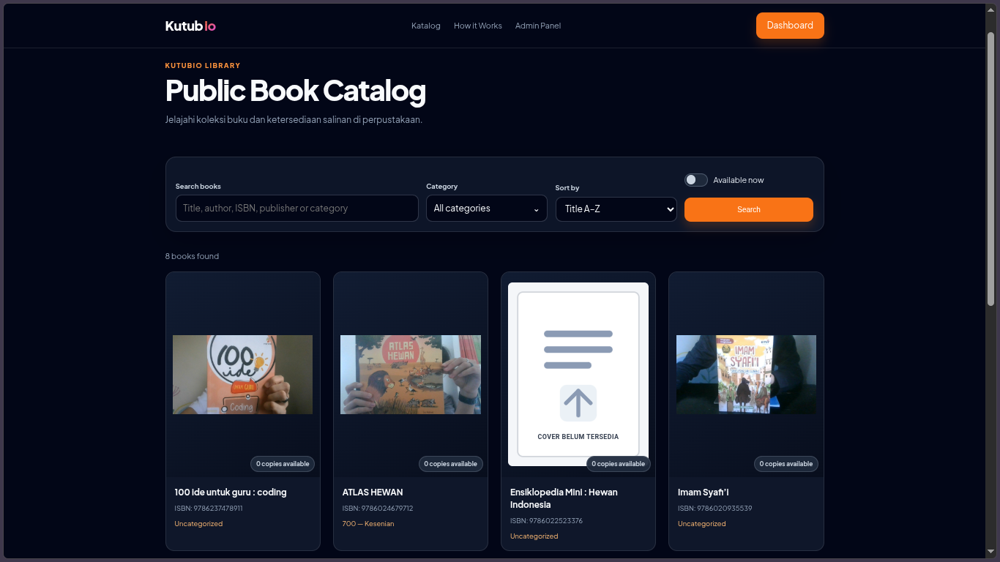
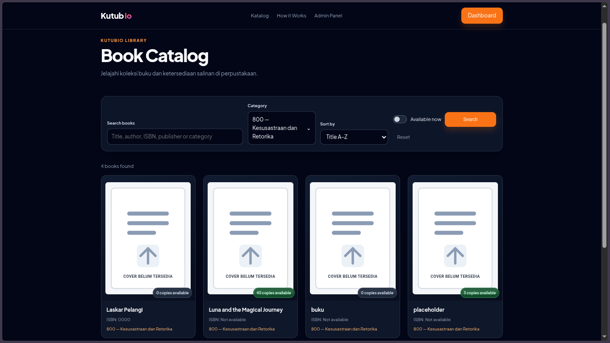
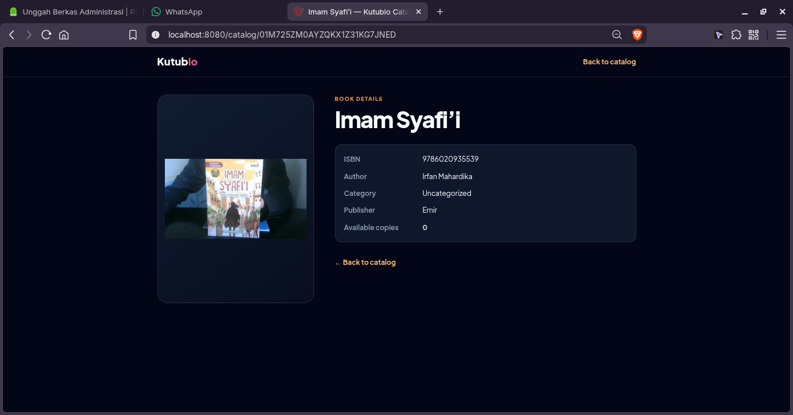

# Kutubio

[Baca dokumentasi dalam Bahasa Indonesia](README.id.md)

Kutubio is a school-library catalog and circulation system. Staff manage book records and physical copies, borrower records, loans, intake, QR/barcode workflows, and print materials. Visitors can browse the public catalog without signing in.

## Contents

- [Features](#features)
- [Technology](#technology)
- [Requirements](#requirements)
- [Local development](#local-development)
- [Public catalog](#public-catalog)
- [Admin workflows](#admin-workflows)
- [Optional services](#optional-services)
- [Configuration](#configuration)
- [Tests and code style](#tests-and-code-style)
- [Production notes](#production-notes)
- [Screenshots](#screenshots)

## Features

### Public catalog

- Guest-accessible, read-only catalog at `/` with paginated cards.
- Cards show cover or placeholder, title, ISBN, category, and number of available physical copies.
- Search suggestions and the matching card grid update together after a brief typing pause. Search covers book metadata only; it never searches borrowers or loans.
- Filter by category and availability; sort by title, recently added, or available-copy count.
- Card links open a separate public, read-only book detail page. It shows approved bibliographic fields and synopsis, without administration actions, borrower/loan records, or physical-copy details.
- Public cover delivery is limited to the `book-covers/` paths.

### Books and physical copies

- Maintain bibliographic records: title, subtitle, authors, ISBN, publisher, page count, category, and synopsis.
- A book can have multiple physical copies, each with its own public ID, QR payload, circulation status, funding source, purchase year, tracking code, acquisition date, and location note.
- Add copies from the book's Copies table. Select copies for printing, supported bulk edits, or deletion.
- Bulk edits preserve fields left unchanged. Borrowed copies are excluded from availability transitions; bulk edit cannot assign Borrowed. Public IDs and QR payloads are immutable.
- Soft-deleting a book soft-deletes its copies; the database foreign key cascades hard deletes.

### Capture Book intake

- Scan an ISBN barcode or enter ISBN manually, then look up local and external bibliographic metadata.
- Metadata providers include Perpusnas, an Indonesian catalog dataset, Google Books, and Open Library.
- Capture a cover with the browser camera or choose an image file. A new image remains a draft until Save Book; saving replaces the active cover.
- A matching local ISBN updates its existing book. A new book can be saved with zero copies.
- Author is required. Author Name Style defaults to Local; category is optional and searchable by name or DDC.

### Borrowers and circulation

- Manage student, teacher, staff, and guest borrowers.
- Import rosters from Google Sheets through CSV retrieval, preview, review, and explicit approval.
- Import IDs follow `student-YYZZAABB`. Example: academic year `26/27`, class `1A`, attendance `01` yields `student-26271101`.
- Create loans for active borrowers and available copies. Returning a loan updates both loan and copy status.
- Filter loans, review active circulation, and print selected loan reports. **Scan Book** is the QR scanning page for circulation.

### Printing and optional AI

- Configure print profiles and generate QR/barcode sticker sheets, book cards, and loan reports.
- Ollama can provide OCR and AI-assisted categorization.
- PDF generation requires a reachable Gotenberg service.

## Technology

- PHP 8.5 (Composer requirement `^8.4`)
- Laravel 13
- Filament 5
- Livewire 4
- PostgreSQL (production; `.env.example` defaults to SQLite)
- Redis and database queues/caches as configured
- Docker Compose / Laravel Sail for local development
- Vite and Tailwind CSS 4
- Optional Ollama and Gotenberg services

## Requirements

- Docker Engine with Docker Compose plugin
- Git
- Repository checkout

Ollama, Gotenberg, and external metadata providers are only needed for their respective workflows. Browser camera access requires HTTPS or localhost and user permission.

## Local development

1. Create local environment configuration:

   ```bash
   cp .env.example .env
   ```

2. Configure `APP_URL`, database settings, and `APP_PORT` as needed. With Sail, use the database hostname from Compose; `localhost` inside a container is not the host machine.
3. Start the services:

   ```bash
   vendor/bin/sail up -d
   ```

4. Install dependencies and initialize the app:

   ```bash
   vendor/bin/sail composer install
   vendor/bin/sail artisan key:generate
   vendor/bin/sail artisan migrate --seed
   vendor/bin/sail npm install
   vendor/bin/sail npm run build
   ```

5. Open the configured local URL (commonly `http://localhost:8080`).

Do not run `migrate:fresh` against a database containing data. Never run it in production.

## Public catalog

- Open `/` without signing in.
- Search by title, author, ISBN, publisher, or category name/DDC. After a short pause while typing, matching recommendations and catalog cards update together.
- Choose a category, availability-only filter, or sort order. Filters and current page are reflected in the URL.
- Select a card to open its public, read-only detail page.
- Available counts include only copies with status Available. Borrowed, Draft, Lost, and other statuses do not count.
- All non-soft-deleted books are currently listed. Public fields include title, ISBN, category, cover, and approved bibliographic details.
- Book covers are intentionally guest-accessible. Do not put confidential files in public cover storage paths.

## Public catalog

- Open `/` without signing in.
- Search by title, author, ISBN, publisher, or category name/DDC. After a short pause while typing, matching recommendations and catalog cards update together.
- Choose a category, availability-only filter, or sort order. Filters and current page are reflected in the URL.
- Select a card to open its public, read-only detail page.
- Available counts include only copies with status Available. Borrowed, Draft, Lost, and other statuses do not count.
- All non-soft-deleted books are currently listed. Public fields include title, ISBN, category, cover, and approved bibliographic details.
- Book covers are intentionally guest-accessible. Do not put confidential files in public cover storage paths.








1. Sign in and open **Library → Books**.
2. Create the bibliographic record.
3. Open the book's Edit page and add physical copies from the Copies table.
4. Set quantity and acquisition details.

### Capture a book by ISBN

1. Open **Capture Book** in the admin navigation.
2. Allow camera access to scan an ISBN, or enter it manually. The camera starts automatically where browser policy permits; use HTTPS/localhost and grant camera permission.
3. Review the matching local book or provider metadata. The scanner panel changes to the active cover or placeholder.
4. Optionally capture/retake a cover using the browser camera, or choose a file.
5. Enter the required author, author name style, optional category, copy quantity, funding source, and purchase year; save.
6. Choose **Scan Another ISBN** to clear the intake form and start a fresh scan.

Provider metadata is a draft. Review it before saving, particularly when source data is malformed or incomplete.

### Edit copies in bulk

1. Open **Book Copies** or a book's Copies table.
2. Select copy rows and choose **Edit Selected**.
3. Change supported fields; leave other values unchanged.
4. Borrowed copies cannot be changed by bulk availability actions. Public IDs and QR payloads cannot be edited.

### Import borrowers

1. Open **Circulation → Borrowers → Import Google Sheet**.
2. Enter an accessible Google Sheets URL and academic year.
3. Fetch the CSV preview and review original/normalized values, generated IDs, match candidates, and warnings.
4. Correct, match, or ignore rows needing review.
5. Choose **Approve & Import** after reviewing the preview.

### Manage circulation

1. Open **Circulation → Loans** and create a loan for an active borrower and available copy.
2. Set loan and due dates.
3. Use Return to mark the loan returned and make the copy available.
4. Filter/sort loan rows or print selected reports. Use **Scan Book** for QR circulation.

## Optional services

### Ollama

Configure the endpoint and model names in `.env` if OCR or AI categorization is enabled:

```env
OLLAMA_URL=http://ollama-host:11434
OLLAMA_VISION_MODEL=glm-ocr:latest
OLLAMA_LLM_MODEL=llama3.1:latest
```

Verify connectivity from the application container. Restrict Ollama to a trusted private network; do not expose it to the public internet.

### Gotenberg

Set `GOTENBERG_ENDPOINT` for PDF rendering and verify the endpoint is reachable from the application container.

## Configuration

Common settings include `APP_NAME`, `APP_ENV`, `APP_KEY`, `APP_URL`, `APP_PORT`, `DB_*`, `QUEUE_CONNECTION`, `CACHE_STORE`, `SESSION_DRIVER`, `FILESYSTEM_DISK`, optional `OLLAMA_*`, and `GOTENBERG_ENDPOINT`. `.env.example` is the canonical environment-key list.

Never commit `.env`, credentials, API keys, or production backups.

## Tests and code style

Run PHP, Artisan, Composer, and Node commands through Sail:

```bash
vendor/bin/sail bin pint --dirty --format agent
vendor/bin/sail artisan test --compact
```

Focused suites:

```bash
vendor/bin/sail artisan test --compact tests/Feature/PublicBookCatalogTest.php
vendor/bin/sail artisan test --compact tests/Feature/CaptureBookPageTest.php
vendor/bin/sail artisan test --compact tests/Feature/CaptureBookCoverTest.php
vendor/bin/sail artisan test --compact tests/Feature/BookCoverDisplayTest.php
```

The project uses PHPUnit. A `.phpunit.result.cache` permission warning may appear in restricted containers; check the test result separately.

## Production notes

- Deploy reviewed changes through the release process; local Sail settings are not production settings.
- Back up the database before migrations. Run additive migrations with `php artisan migrate --force` inside the production application container.
- Never run `migrate:fresh` in production.
- Verify `APP_URL`, HTTPS, storage URL/route configuration, queues, and optional services.
- Smoke-test public catalog/detail/cover delivery, admin sign-in, capture intake, copies, circulation, borrower import, and PDF output.
- Public catalog covers are intentionally visible to guests; keep private uploads outside allowed cover paths.

